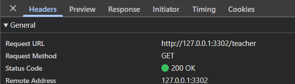
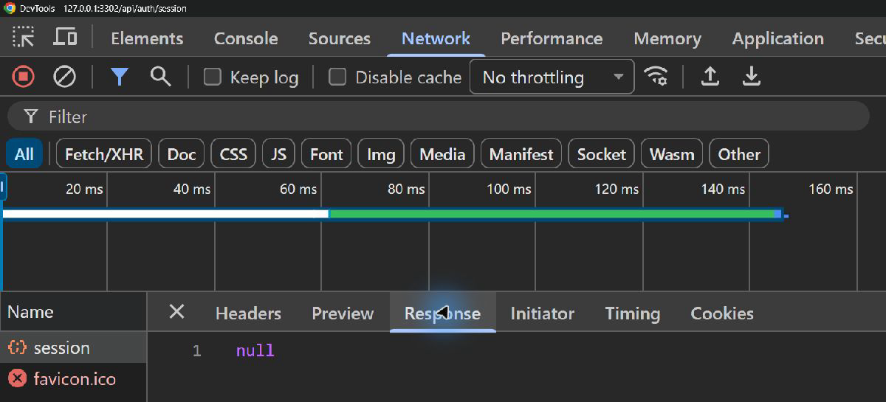
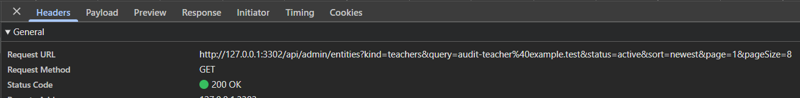
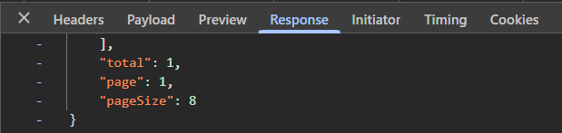

# Happy Town IT Security Audit

Óbuda University · John von Neumann Faculty of Informatics

IT Audit, Compliance and Risk Management

**Student auditors** Bakdaulet Bokenbayev and Assel Karzhau

**Fieldwork and follow-up** 19–22 November 2026

**Audited revision** f23375fee54bae8942a1c23a702adb04ed6c99a2

## Contents

- [Executive summary](#executive-summary)
- [Introduction and audit objectives](#introduction-and-audit-objectives)
- [Audit scope and exclusions](#audit-scope-and-exclusions)
- [Application overview and architecture](#application-overview-and-architecture)
- [Audit team and independence](#audit-team-and-independence)
- [Audit plan and timeline](#audit-plan-and-timeline)
- [Audit criteria and decision rules](#audit-criteria-and-decision-rules)
- [Audit methodology](#audit-methodology)
- [Tools and testing environment](#tools-and-testing-environment)
- [Investigation and technical analysis](#investigation-and-technical-analysis)
- [ASVS verification results](#asvs-verification-results)
- [Identified security findings](#identified-security-findings)
- [Risk assessment](#risk-assessment)
- [Recommendations and corrective action plan](#recommendations-and-corrective-action-plan)
- [Audit limitations](#audit-limitations)
- [Auditor Experience and Lessons Learned](#auditor-experience-and-lessons-learned)
- [Conclusion](#conclusion)
- [References](#references)
- [Evidence index and appendices](#evidence-index-and-appendices)
- [AI-use disclosure](#ai-use-disclosure)

## Executive summary

This academic audit assessed 17 selected OWASP ASVS 5.0.0 Level 1 requirements for the self-hosted Happy Town application at one local revision. The evidence supports 11 Pass, 6 Fail and 0 Inconclusive requirement verdicts. Four findings remain open, one Medium and three Low.

Sampled role and record controls returned the expected allow and deny decisions. The principal weakness is missing server-side session termination at replacement and logout. Other findings concern contact values in request URLs, credential-abuse documentation and settings, and authorization documentation. The sample provides point-in-time assurance over the inspected controls.

## Introduction and audit objectives

Happy Town supports learning-centre administration, teaching and parent access. The audit evaluates the selected protection of sign-in, session handling, input validation, and permissions for functions and records. It also examines whether the project documents describe its key control rules.

The investigation tested ordinary behavior with synthetic accounts, traced the corresponding code and assessed each outcome against the selected criterion. The findings and recommendations are for the audited build.

## Audit scope and exclusions

The sample covers sign-in, sign-out, the administrator management API, role portals, selected student and group reads, the reviewed project documents, and relevant seed, schema and configuration. It includes ADMIN, TEACHER, PARENT and anonymous cases where applicable.

The review excludes production, real student data, external services, infrastructure hardening, TLS, payments, analytics and routes outside the sample. The findings apply to the point-in-time local build. They do not establish full Level 1 conformity or ASVS certification.

[Audit scope](../../security-audit/methodology/audit-scope.md) · [Audit plan and authorization](../../security-audit/audit-plan/audit-plan.md)

## Application overview and architecture

The browser uses the Next.js and React interface. The Next.js server processes application routes, Auth.js Credentials sign-in and JWT-backed sessions. Backend guards reload account state and check roles or relationships. Prisma uses PostgreSQL for application records and authentication audit events.

*Table 1. Audited application architecture.*

| Layer | Application role | Trust boundary |
| --- | --- | --- |
| Browser | Next.js and React interface | User input, navigation and browser session state |
| Server | Next.js routes and Auth.js | Checks session and account before the applicable role or relationship rule |
| Data | Prisma and PostgreSQL | Stores application records, relationships and audit events |

## Audit team and independence

The audit plan names Bakdaulet Bokenbayev as lead student auditor and Project Owner, and Assel Karzhau as student auditor. Both participated in developing Happy Town. This academic technical assessment is therefore subject to a self-review limitation. It provides no independent external assurance.

The record supports audit-team activities and the Project Owner’s baseline approval. Individual contributions or personal reflections beyond these records require student confirmation.

## Audit plan and timeline

*Table 2. Fieldwork and follow-up chronology, CET.*

| Date | Audit activity | Evidence or decision |
| --- | --- | --- |
| 19 Nov 2026 | Lab setup and authorized original fieldwork | Loopback port 3300, source, HTTP and database evidence |
| 19 Nov 2026 | Documentation reassessment | Reviewed HT-05 and HT-13 against the available inventory |
| 20 Nov 2026 | Isolated follow-up | Port 3302, synthetic fixture validation and browser checks |
| 21 Nov 2026 | Baseline approval and adjudication | Prospective HT-07 comparison and session source reviews |
| 22 Nov 2026 | User-operated captures and final review | HT-11 separate contexts and HT-17 paired browser observations |

[Audit plan and authorization](../../security-audit/audit-plan/audit-plan.md) · [Original execution record](../../security-audit/methodology/test-execution.md)

## Audit criteria and decision rules

The 17 selected requirement IDs and their retained wording were checked against the OWASP ASVS 5.0.0 English release CSV. All 17 map to Level 1. The workbook paraphrases each criterion and points to the official release for exact wording.

Pass means sufficient evidence supports compliance in the sample. Fail means sufficient evidence establishes a deviation. Inconclusive means the evidence cannot establish either result. Not Applicable requires a documented reason. Requirement verdicts and unresolved parts of individual dynamic scenarios are reported separately.

[Official OWASP ASVS 5.0.0 English criteria](https://raw.githubusercontent.com/OWASP/ASVS/v5.0.0/5.0/docs_en/OWASP_Application_Security_Verification_Standard_5.0.0_en.csv) · [Source verification matrix](../../security-audit/asvs/verification-matrix.csv)

## Audit methodology

Select cases by risk and applicability, identify expected behavior, inspect the audited code and documents, compare retained positive and negative observations, then record the evidence and decision. The final review independently reconciled the selected ASVS criteria, working papers, browser records and finding links.

A source or configuration inspection can establish a design deviation. Dynamic evidence describes a response actually observed. Documentation review establishes the completeness of the reviewed material. An offline provider or expiry check does not establish a live HTTP result.

## Tools and testing environment

The audited commit is f23375fee54bae8942a1c23a702adb04ed6c99a2. Original fieldwork used a local development listener on port 3300. Follow-up used port 3302 and the isolated happy_town_audit_test database. The retained environment record identifies Node.js, Next.js, React, Auth.js, Prisma and PostgreSQL running under the audit Docker Compose setup.

The original evidence includes HTTP records, Chrome DevTools captures, Playwright observations, source inspection and targeted database checks. Retained screenshots or publication excerpts identify evidence by test ID. This editorial review did not execute new application HTTP requests. It checked the saved evidence, audited source and release artifacts.

[Audited environment](../../security-audit/evidence/phase-3/environment.md) · [Original execution record](../../security-audit/methodology/test-execution.md) · [Retained HTTP observations](../../security-audit/evidence/phase-3/observations.json)

## Investigation and technical analysis

### HT-07 Credential-abuse protection

The requirement compares implementation with the application’s security documentation. The observed policy gap and the later mismatch are separate from a live throttle outcome.

*Table 3. Prospective baseline and retained fieldwork.*

| Stage | Evidence | Disposition |
| --- | --- | --- |
| 19 Nov · original fieldwork | No complete approved policy was available. Offline limiter observations and source were preserved. | Inconclusive for HT-07 in the historical record. |
| 21 Nov · policy approval | Owner approved HT07-BASELINE-v0.1 for the isolated build. The sixth failed check within 15 minutes starts a 15-minute pause. | Applies prospectively from approval. |
| 21 Nov · source comparison | The guard stops further checks after five failures. The counter expires ten minutes from the first failure. | Fail against the approved baseline. |
| 22 Nov · evidence review | Retained provider tests used isolated dependencies. Timing was simulated. | Live threshold, denial and timed recovery remain unobserved. |

The audited authentication handler consults the limiter before account lookup and clears failures after successful verification. The rate-limit module applies a fixed window from the first failure. The project did not record an actual HTTP throttle response or timed recovery.

[Approval record](../../security-audit/evidence/supplementary/2026-11-21/remaining-evidence/HT07-baseline-approval.md) · [Approved baseline](../../security-audit/evidence/supplementary/2026-11-21/remaining-evidence/HT07-operational-baseline.md) · [Source adjudication](../../security-audit/evidence/supplementary/2026-11-21/final-adjudication-source-review.md) · [Offline provider output](../../security-audit/evidence/supplementary/2026-11-21/criterion-recheck/ht07-provider-results.txt)

### HT-11 Session replacement

The reviewed Auth.js flow issues fresh session tokens. The protected route verifies JWT validity and active account state, with no server-side decision that terminates the predecessor at re-authentication. The source supports Fail.

In the retained 22 November sequence A signed in before B used the same synthetic teacher account. A did not sign in again. Its subsequent GET /teacher returned HTTP 200 and rendered the dashboard. This measures continued access across separate sign-ins. Acceptance of an exact superseded credential remains unobserved.

*Figure 1. HT11-UO-01. Context A received HTTP 200 for GET /teacher.*

[HT-11 source trace](../../security-audit/evidence/supplementary/2026-11-20/ht11-independent-source-review/HT11-fail-determination-and-proposed-changes.md) · [HT-11 Playwright sequence](../../security-audit/evidence/supplementary/2026-11-22/user-operated-devtools/HT11-UO-PW-playwright-observation.json)

### HT-12 Ordinary logout and backend termination

Original fieldwork recorded a 302 from sign-out and a 401 from a protected API after the browser dropped its cookie. An isolated follow-up recorded a 200 sign-out response and a session response without a user. These results establish ordinary logout. They leave acceptance of the earlier credential unobserved.

Source inspection identifies cookie cleanup without an application revocation record or a session-version check on the verified path. This establishes the source-based Fail. An offline dummy-token expiry observation tests a different condition. A separate signed-out page returned 500 in original fieldwork. It did not expose portal content and supplies no evidence about an earlier credential.

*Figure 2. Retained HT-12 Chrome Response showing the signed-out session state.*

[Source adjudication](../../security-audit/evidence/supplementary/2026-11-21/final-adjudication-source-review.md) · [Ordinary logout HTTP record](../../Happy-Town-Academic-Submission-2026-11-22/evidence/ordinary-logout-http.json) · [Retained HTTP observations](../../security-audit/evidence/phase-3/observations.json)

### HT-05 and HT-13 Documentation

HT-05 covers the available documentation for credential-abuse defenses and malicious-lockout safeguards. HT-13 covers the governing rules for functions and records. Missing documented details establish deviations against these documentation requirements. Separate HTTP and source evidence supports the runtime authorization verdicts in the sampled paths.

[Documentation reassessment](../../security-audit/evidence/reassessment/2026-11-19-documentation-review.md) · [Function-level native captures](../../security-audit/evidence/supplementary/2026-11-21/chrome-native-devtools-captures/evidence-index.md) · [Record-level publication captures](../../security-audit/evidence/supplementary/2026-11-21/submission-redactions/HT-15/README.md)

### HT-17 Contact values in URLs

The administrator’s free-text Teachers filter sends its value as a GET query parameter. A real request in the isolated lab recorded the synthetic email in the URL, and the paired response contained one result. These observations establish request placement. The review did not observe URL retention, onward sharing or disclosure.

*Figure 3. HT17-UO-01. Chrome Headers show the synthetic query value and HTTP 200.*

*Figure 4. HT17-UO-02. Chrome Response shows a total of one matching result.*

[User-operated capture index](../../security-audit/evidence/supplementary/2026-11-22/user-operated-devtools/evidence-index.md) · [HT-17 Playwright result](../../security-audit/evidence/supplementary/2026-11-22/user-operated-devtools/HT17-UO-PW-playwright-observation.json)

### Sampled function and record controls

*Table 4. Selected authorization observations.*

| Case | Allowed control | Denied controls |
| --- | --- | --- |
| HT-14 | ADMIN management read returned 200 with items | TEACHER and PARENT returned 403. Anonymous returned 401. |
| HT-15 | A linked synthetic student returned 200 with the record | An unlinked record returned 404 without student data. |

[Function-level native captures](../../security-audit/evidence/supplementary/2026-11-21/chrome-native-devtools-captures/evidence-index.md) · [Record-level publication captures](../../security-audit/evidence/supplementary/2026-11-21/submission-redactions/HT-15/README.md)

## ASVS verification results

The final matrix retains all 17 requirement verdicts. The original 19 November working papers and the intermediate reviews preserve their dated decisions. The prospective baseline explains the later HT-07 Fail. The matrix workbook records the evidence basis and identified limitation for each requirement.

*Table 5. Final assessment of 17 selected Level 1 requirements.*

| Test | ASVS 5.0.0 | Verification focus | Verdict | Finding |
| --- | --- | --- | --- | --- |
| HT-01 | 1.2.4 | Protected database queries | Pass | — |
| HT-02 | 2.2.1 | Business and security input validation | Pass | — |
| HT-03 | 2.2.2 | Validation at the trusted layer | Pass | — |
| HT-04 | 3.5.3 | Methods for sensitive operations | Pass | — |
| HT-05 | 6.1.1 | Credential-abuse documentation | Fail | HT-F03 |
| HT-06 | 6.2.6 | Password masking | Pass | — |
| HT-07 | 6.3.1 | Credential-abuse implementation | Fail | HT-F03 |
| HT-08 | 6.3.2 | Default accounts | Pass | — |
| HT-09 | 7.2.1 | Backend token verification | Pass | — |
| HT-10 | 7.2.2 | Fresh dynamic session tokens | Pass | — |
| HT-11 | 7.2.4 | Prior session termination on authentication | Fail | HT-F01 |
| HT-12 | 7.4.1 | Server-side termination after logout | Fail | HT-F01 |
| HT-13 | 8.1.1 | Authorization documentation | Fail | HT-F04 |
| HT-14 | 8.2.1 | Function-level authorization | Pass | — |
| HT-15 | 8.2.2 | Record-level authorization | Pass | — |
| HT-16 | 8.3.1 | Trusted-layer authorization | Pass | — |
| HT-17 | 14.2.1 | Sensitive values in request URLs | Fail | HT-F02 |

Final totals are 11 Pass, 6 Fail, 0 Inconclusive and 0 Not Applicable. All six Fail verdicts map to the four open findings.

[Final verification workbook](../../deliverables/final/ASVS_Verification_Matrix.xlsx) · [Evidence index](../../deliverables/final/Evidence_Index.md) · [Original matrix](../../security-audit/asvs/verification-matrix.csv)

## Identified security findings

### HT-F01 Missing server-side session invalidation

HT-11, HT-12 · ASVS 7.2.4, 7.4.1 · Medium · Open

**Expected** End the original session when replaced or logged out and enforce the decision on the server.

**Observed** JWT sign-out clears the browser cookie. The inspected verifier has no replacement or revocation decision for the prior session. Two independent contexts remained usable and ordinary logout was observed.

**Cause** Self-contained JWTs lack an applicable backend revocation record or equivalent cutoff.

**Impact** If an earlier active credential were available to someone with lab access, its role could continue to authorize requests. Privileged roles could affect management data. Those prerequisites and continued exact-credential use were not demonstrated.

[HT-11 source trace](../../security-audit/evidence/supplementary/2026-11-20/ht11-independent-source-review/HT11-fail-determination-and-proposed-changes.md) · [Source adjudication](../../security-audit/evidence/supplementary/2026-11-21/final-adjudication-source-review.md) · [HT-11 Playwright sequence](../../security-audit/evidence/supplementary/2026-11-22/user-operated-devtools/HT11-UO-PW-playwright-observation.json) · [Ordinary logout HTTP record](../../Happy-Town-Academic-Submission-2026-11-22/evidence/ordinary-logout-http.json)

### HT-F02 Contact search value in a GET URL

HT-17 · ASVS 14.2.1 · Low · Open

**Expected** Keep sensitive inputs in the message body or headers.

**Observed** The authorized Teachers search placed the synthetic email in the request URL. HTTP 200 returned one result. Downstream retention is unverified.

**Cause** The client serializes free-text contact input into a query parameter and the endpoint searches email.

**Impact** A component that records URLs could retain the contact value. The sample established request placement only.

[User-operated capture index](../../security-audit/evidence/supplementary/2026-11-22/user-operated-devtools/evidence-index.md) · [HT-17 Playwright result](../../security-audit/evidence/supplementary/2026-11-22/user-operated-devtools/HT17-UO-PW-playwright-observation.json)

### Documentation and baseline findings

### HT-F03 Credential-abuse policy and implementation mismatch

HT-05, HT-07 · ASVS 6.1.1, 6.3.1 · Low · Open

**Expected** Document the protections and safeguards. Apply the approved behavior prospectively.

**Observed** The reviewed application documentation was incomplete. A later owner-approved baseline differs from the fixed threshold and timing at the audited revision. Live behavior was not verified.

**Cause** The versioned application documentation lacked the settings and safeguards. The inspected implementation fixes a different threshold and expiry calculation.

**Impact** Inconsistent criteria make maintenance and validation less reliable. Unintended delays or earlier recovery are possible under the compared logic. No live outage or successful attack was observed.

[Documentation reassessment](../../security-audit/evidence/reassessment/2026-11-19-documentation-review.md) · [Approved baseline](../../security-audit/evidence/supplementary/2026-11-21/remaining-evidence/HT07-operational-baseline.md) · [Approval record](../../security-audit/evidence/supplementary/2026-11-21/remaining-evidence/HT07-baseline-approval.md) · [Source adjudication](../../security-audit/evidence/supplementary/2026-11-21/final-adjudication-source-review.md) · [Offline provider output](../../security-audit/evidence/supplementary/2026-11-21/criterion-recheck/ht07-provider-results.txt)

### HT-F04 Incomplete authorization policy documentation

HT-13 · ASVS 8.1.1 · Low · Open

**Expected** Document function and record rules using permissions and resource attributes.

**Observed** The reviewed documentation gives broad rules but omits detailed permissions and relationship states. Sampled runtime enforcement held.

**Cause** The available project documents lacked a maintained role–function–resource specification.

**Impact** Future changes could treat a role or relationship inconsistently and expose a bounded record set. That effect depends on a later implementation or review error.

[Documentation reassessment](../../security-audit/evidence/reassessment/2026-11-19-documentation-review.md) · [Function-level native captures](../../security-audit/evidence/supplementary/2026-11-21/chrome-native-devtools-captures/evidence-index.md) · [Record-level publication captures](../../security-audit/evidence/supplementary/2026-11-21/submission-redactions/HT-15/README.md)

[Final findings workbook](../../deliverables/final/Security_Findings_Register.xlsx) · [Canonical findings](../../security-audit/findings/findings-register.csv)

## Risk assessment

Rate likelihood and impact on the same ordinal scale. Low is 1, Medium is 2 and High is 3. Multiply the two values. Scores 1–2 are Low, 3–4 Medium, 6 High and 9 Critical. This numeric display preserves the earlier qualitative matrix and ranks the observed local risk. The values do not quantify probability, monetary loss or production exposure.

*Table 6. Likelihood × Impact matrix.*

| Likelihood ↓ / Impact → | Low (1) | Medium (2) | High (3) |
| --- | --- | --- | --- |
| Low (1) | 1 · Low | 2 · Low · HT-F04 | 3 · Medium · HT-F01 |
| Medium (2) | 2 · Low · HT-F02/03 | 4 · Medium | 6 · High |
| High (3) | 3 · Medium | 6 · High | 9 · Critical |

*Table 7. Finding ratings.*

| Finding | Likelihood | Impact | Score | Risk |
| --- | --- | --- | --- | --- |
| HT-F01 | 1 | 3 | 3 | Medium |
| HT-F02 | 2 | 1 | 2 | Low |
| HT-F03 | 2 | 1 | 2 | Low |
| HT-F04 | 1 | 2 | 2 | Low |

HT-F01 has Low likelihood because use of a still-valid earlier credential and local reachability are separate prerequisites. Its possible privileged reach supports High impact. The other three ratings reflect bounded contact or documentation effects, with no confirmed downstream disclosure or site-wide consequence.

## Recommendations and corrective action plan

*Table 8. Proposed corrective actions. All items are open.*

| Priority | Proposed owner | Action |
| --- | --- | --- |
| P1 · HT-F01 | Authentication maintainer | Implement server-enforced session termination for logout and re-authentication. Keep the decision consistent across the protected services. |
| P2 · HT-F02 | Admin portal and API maintainer | Move contact search values to a validated request body and review logging and retention rules for the field. |
| P2 · HT-F03 | Project Owner and authentication maintainer | Maintain a versioned policy, specify safeguards and recovery, then align the implementation after owner approval. |
| P3 · HT-F04 | Project Owner and authorization maintainer | Publish a role–permission matrix covering ownership, assignment, lifecycle states and exceptions. |

### Retest and risk treatment

*Table 9. Retest acceptance evidence.*

| Finding | Closure evidence |
| --- | --- |
| HT-F01 | Review the new termination state and backend enforcement. Confirm that isolated lifecycle tests distinguish active, replaced, logged-out and expired sessions. Retain sanitized outcomes. |
| HT-F02 | Run an authorized search using a synthetic marker. Verify its absence from the URL and review the authorized retention controls. |
| HT-F03 | Compare updated policy, configuration and source. Independently validate the limiter decisions, account isolation and recovery in approved test fixtures. |
| HT-F04 | Trace each documented rule to its server gate and compare allowed and denied synthetic examples against the matrix. |

[Final risk workbook](../../deliverables/final/Risk_Assessment.xlsx) · [Historical risk assessment](../../security-audit/findings/risk-assessment.md)

## Audit limitations

Reviews were confined to the audited revision, loopback listeners and synthetic accounts. Coverage of the selected routes and fixtures does not establish how unsampled routes or production infrastructure behave.

For HT-07, no live rate-limit denial or timed recovery was observed. For HT-11, acceptance of the exact superseded credential remains unobserved. For HT-12, ordinary logout is evidenced and acceptance of the original pre-logout session remains unobserved. Retained values are intentionally redacted or summarized where sensitive. HT-17 secondary retention was outside the observation.

## Auditor Experience and Lessons Learned

The retained working papers show that the audit team combined source tracing with browser and HTTP observations, used synthetic role and relationship fixtures, checked selected database outcomes and maintained evidence references. Documented challenges included split sign-in and session transitions, unavailable complete operational documentation during fieldwork, and test coverage restricted to the isolated environment.

The fieldwork illustrates how backend identity verification and token issuance can work even when session termination is missing. Concurrent browser access and a signed-out browser answer different questions from revocation. Role checks and record relationships also need separate positive and negative observations. In the next assessment, approve the security baseline before testing, define lifecycle states in advance and commission review by someone outside the development team.

Student confirmation pending for individually attributed activities, personal reflections and any precise division of duties beyond the audit plan.

## Conclusion

The verified requirement-level assessment is 11 Pass, 6 Fail and 0 Inconclusive across 17 selected requirements. Four findings remain open. Prioritize server-side session termination, then address sensitive search values and maintain the two control policies. The recommendations are proposed corrective actions. This review did not implement them.

## References

[OWASP ASVS 5.0.0 official English release data](https://raw.githubusercontent.com/OWASP/ASVS/v5.0.0/5.0/docs_en/OWASP_Application_Security_Verification_Standard_5.0.0_en.csv) · [OWASP ASVS download page](https://asvs.owasp.org/downloads/) · [Audit plan](../../security-audit/audit-plan/audit-plan.md) · [Canonical evidence register](../../security-audit/evidence/evidence-register.md)

## Evidence index and appendices

The separate evidence index links each test to its working paper and identifies important original or publication artifacts. Figure captions distinguish native Chrome captures and condensed excerpts. See the spreadsheet trio for case-level methodology, findings and numeric risk calculations.

[Final evidence index](../../deliverables/final/Evidence_Index.md) · [Verification workbook](../../deliverables/final/ASVS_Verification_Matrix.xlsx) · [Findings workbook](../../deliverables/final/Security_Findings_Register.xlsx) · [Risk workbook](../../deliverables/final/Risk_Assessment.xlsx)

## AI-use disclosure

OpenAI Codex (GPT-6 family) assisted with evidence organization, cross-checks, revision of the report and preparation of the presentation and workbooks. Claims about fieldwork are sourced to retained records. User-operated screenshots are identified separately. The students are responsible for confirming personal statements and applying their course’s AI-use rules.

[Earlier AI-use disclosure](../../security-audit/reports/ai-use-disclosure.md)
