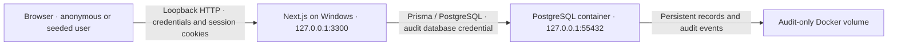

# Application overview

Happy Town is an existing English learning centre management application co-developed by Bakdaulet Bokenbayev and Assel Karzhau. It organizes student and group records, assignments, attendance, homework and progress. Its three user roles, credential-based login, JWT-backed sessions and persistent records support a focused audit sample. The private package has no tracked license file at the inspected revision. Bakdaulet, the Project Owner, authorized source inspection for the coursework. The Phase 3 Working Papers reference source paths and line ranges.

## Configuration inventory

The application was inspected at commit `f23375fee54bae8942a1c23a702adb04ed6c99a2`. Source and package paths below are relative to the repository root. Runtime observations are recorded in the [environment evidence](../evidence/phase-1-environment.md).

| Component | Technology and verification basis |
| --- | --- |
| Frontend | Next.js App Router with React 19.2.8 and Tailwind CSS 4.2.1. Installed versions checked against `package-lock.json`. |
| Backend | Next.js 16.2.12 on Node.js 24.16.0, with TypeScript 5.9.3 and Zod 4.4.3. API route handlers and server-rendered pages use shared server-side guards, services and repositories. Versions checked locally. |
| Persistence | PostgreSQL 17.10 verified in the audit container. Prisma and Prisma Client 7.9.1 with the PostgreSQL adapter and `pg` 8.22.0. Committed migrations and `prisma/schema.prisma` define the model. |
| Web server | Next.js development HTTP server on `127.0.0.1:3300`. The audit topology has no reverse proxy or TLS terminator. |
| Authentication | Auth.js (`next-auth` 5.0.0-beta.32), Credentials provider, 12-digit IIN and password. `auth.ts` uses bcryptjs 3.0.3 for password comparison and JWT sessions with a configured maximum age of eight hours. Installed versions and source configuration checked. |
| Deployment | Node process on the Windows host and PostgreSQL in a dedicated Docker Compose project with a named volume. The root Compose file is the application's existing development configuration. The [audit Compose file](../compose.yaml) isolates the audit data. |

## Architecture and trust boundaries

- **Browser to application.** Treat browser state, requests and supplied identifiers as untrusted. The browser handles session cookies. Server-side handlers determine identity and permissions using `auth.ts`, `lib/auth/authorization.ts` and selected service and route logic.
- **Application to datastore.** The server uses an audit-only database credential to read or change records. The database stores user identities and password hashes, role relationships, learning records and audit events. User-level access decisions are made in the application layer. The seed and operator tools have separate access to the datastore.
- **Lab and evidence boundary.** Keep the audit instance on loopback and use a dedicated synthetic database. The existing machine-local PostgreSQL instance on port 5432 and hosted configurations are outside the lab. Restrict access to local secrets, the audit volume and working papers.

## Application users and assets

| User category | Intended use in the sample |
| --- | --- |
| Anonymous | Open the sign-in page and initiate authentication. |
| ADMIN | Manage school entities and relationships and view relevant operational records. |
| TEACHER | View or maintain learning data for assigned groups and students, subject to permission checks. |
| PARENT | View permitted information about linked students. |
| Student | A domain record associated with parents and groups. The application models student records without a student login. |

The development seed creates 23 user records and 24 student records. One account for each authenticated role receives credentials. The principal assets for fieldwork are student and parent information, group and student assignments, credentials and sessions, and audit events used to corroborate activity. The table describes the intended role model. Detailed permissions and their enforcement are subject to later audit verification.

## Preliminary information to confirm

The Phase 1 source and runtime checks substantiate the component inventory and basic sign-in, portal access and sign-out. The Project Owner operates the local lab and controls access to Audit Evidence. Phase 3 confirmed the environment and synthetic fixture relationships for its sample. The development topology limits conclusions about production deployments. [Authorization record](../audit-plan/audit-plan.md#authorization-checklist) · [Phase 3 environment](../evidence/phase-3/environment.md)
