# Security Audit of Happy Town

## 1. Cover page

| Item | Detail |
| --- | --- |
| Application | Happy Town |
| Deliverable | Final academic audit report |
| Institution | Óbuda University |
| Course | IT Audit, Compliance and Risk Management |
| Audit standard | OWASP ASVS 5.0.0, 17 selected Level 1 requirements |
| Auditors | Bakdaulet Bokenbayev and Assel Karzhau |
| Roles | Bakdaulet Bokenbayev — Lead Auditor, Co-Developer and Project Owner. Assel Karzhau — Auditor and Co-Developer. |
| Fieldwork date | 19 November 2026 |
| Reassessment date | 19 November 2026, after fieldwork |
| Report revision date | 21 November 2026, evidence review edition |
| Intended recipients | Project Owner and designated course assessors |

## 2. Table of contents

| Sections 3–10 | Page | Sections 11–18 | Page |
| --- | ---: | --- | ---: |
| [3. Executive summary](#3-executive-summary) | 2 | [11. Detailed audit execution and evidence](#11-detailed-audit-execution-and-evidence) | 4 |
| [4. Introduction and audit background](#4-introduction-and-audit-background) | 2 | [12. Verification results](#12-verification-results) | 11 |
| [5. Audit objective and criteria](#5-audit-objective-and-criteria) | 3 | [13. Detailed findings](#13-detailed-findings) | 11 |
| [6. Audit subject and technical environment](#6-audit-subject-and-technical-environment) | 3 | [14. Risk assessment and risk matrix](#14-risk-assessment-and-risk-matrix) | 12 |
| [7. Audit scope and limitations](#7-audit-scope-and-limitations) | 3 | [15. Recommendations and corrective action plan](#15-recommendations-and-corrective-action-plan) | 13 |
| [8. Audit team and independence](#8-audit-team-and-independence) | 3 | [16. Overall conclusion](#16-overall-conclusion) | 13 |
| [9. Audit plan and methodology](#9-audit-plan-and-methodology) | 4 | [17. References](#17-references) | 13 |
| [10. Tools and testing techniques](#10-tools-and-testing-techniques) | 4 | [18. Evidence traceability appendix](#18-evidence-traceability-appendix) | 14 |

| Exhibits | Page | Exhibits | Page |
| --- | ---: | --- | ---: |
| [A. Audited environment](#exhibit-a--audited-environment) | 4 | [E. JWT logout invalidation](#exhibit-e--jwt-logout-invalidation) | 7 |
| [B. Authentication checks](#exhibit-b--authentication-checks) | 5 | [F. Contact search URL](#exhibit-f--sensitive-contact-search-in-a-request-url) | 8 |
| [C. Function-level authorization](#exhibit-c--function-level-authorization) | 6 | [G. Credential-abuse documentation](#exhibit-g--credential-abuse-documentation) | 9 |
| [D. Record-level authorization](#exhibit-d--record-level-authorization) | 6 | [H. Authorization documentation](#exhibit-h--authorization-documentation) | 9 |
| [I. Isolated contact-search validation](#exhibit-i--isolated-contact-search-validation) | 10 |  |  |

[Native authorization exhibits HT14-01 to HT15-02](#evidence-exhibit-ht14-01) · pages 16–21

## 3. Executive summary

The Audit Team assessed selected controls in Happy Town, an English learning centre management web application. Original fieldwork used the loopback lab on port 3300. Playwright follow-up used the same revision on port 3302 with a copied synthetic database. The audit covered sign-in, sessions, role permissions, student and group access, validation and admin contact search.

The final outcome is **11 Pass, 6 Fail and 0 Inconclusive** across 17 selected OWASP ASVS 5.0.0 Level 1 requirements. The original fieldwork recorded 11 Pass, 2 Fail and 4 Inconclusive. A later documentation review confirmed that the available application documentation did not meet the requirements for credential-abuse protection and authorization rules. The corresponding implementation cases were assessed separately. The [independent HT-11 source review](../evidence/supplementary/2026-11-20/ht11-independent-source-review/HT11-fail-determination-and-proposed-changes.md) found that re-authentication issues a new JWT without revoking the previous JWT. **HT-11 is Fail on source evidence.** The [HT-11 replay record](../evidence/supplementary/2026-11-20/ht11-final-dynamic-20261120T212722Z/HT11-final-dynamic-execution.md) records the Dynamic Replay Test as **Inconclusive**. The follow-up confirmed the synthetic email in the search URL and the browser's signed-out state. Server acceptance of a prior JWT after logout remains untested. The [fieldwork record](../methodology/test-execution.md), [reassessment](../evidence/reassessment/2026-11-19-documentation-review.md) and [verification matrix](../asvs/verification-matrix.csv) document the results.

Four findings are open in the [findings register](../findings/findings-register.csv). Server-side JWT invalidation is **Medium** risk. The contact search URL and both documentation findings are **Low** risk. Prioritize server-side logout invalidation, remove contact terms from search URLs, and document sign-in defenses and access rules.

## 4. Introduction and audit background

The Project Owner authorized this academic investigation for the Óbuda University course. The team reviewed the application it co-developed and reported documented omissions where the audit criteria required documentation. Section 8 explains the self-review limitation. [Audit plan](../audit-plan/audit-plan.md) · [Reassessment record](../evidence/reassessment/2026-11-19-documentation-review.md)

## 5. Audit objective and criteria

The objective was to determine whether sampled safeguards protect account credentials, session state and access to school records. The Audit Criteria are 17 applicable Level 1 requirements from the official English release of OWASP ASVS 5.0.0. The verification matrix records the versioned requirements, official descriptions, outcomes and evidence. Full ASVS conformance and certification fall outside the Audit Scope. [Official ASVS 5.0.0 release](https://asvs.owasp.org/downloads/) · [Verification matrix](../asvs/verification-matrix.csv)

## 6. Audit subject and technical environment

Happy Town manages students, groups, attendance, homework and progress. ADMIN manages accounts, records and relationships. TEACHER works with assigned groups and students. PARENT views linked student records. Student records have no sign-in role.

| Layer | Configuration recorded during fieldwork |
| --- | --- |
| Web application | Next.js 16.2.12 App Router, React 19.2.8, Node.js 24.16.0 on Windows |
| Identity and sessions | Auth.js Credentials via next-auth 5.0.0-beta.32 and @auth/core 0.41.3, bcryptjs and JWT sessions |
| Data access and storage | Prisma 7.9.1 and PostgreSQL 17.10 in the dedicated happy-town-audit Compose project |
| Deployment boundary | Original fieldwork: 127.0.0.1:3300. Follow-up: 127.0.0.1:3302. PostgreSQL bound to 127.0.0.1:55432. |

The application server evaluates identity and access before querying PostgreSQL through Prisma. Fieldwork used revision `f23375fee54bae8942a1c23a702adb04ed6c99a2` on 19 November 2026, approximately 11:39–11:47 CET. [Application overview](../methodology/application-overview.md) · [Environment record](../evidence/phase-3/environment.md)

## 7. Audit scope and limitations

| Boundary | Definition |
| --- | --- |
| Included | Sign-in and sign-out, sessions, the three role portals, representative admin management, student and group reads, and supporting source, configuration and application documentation |
| Excluded | Production, public deployments, live records, third-party infrastructure, unsampled features, host and container hardening, production transport and certification |

The fieldwork was a purposive sample on one revision with synthetic data. Local HTTP limits production transport conclusions. Original headless sign-in automation timed out. Supplementary Playwright sign-ins succeeded against the isolated instance. The reassessment was limited to repository documentation and other available project materials. An off-repository policy was outside the evidence submitted for review. [Audit scope](../methodology/audit-scope.md) · [Original execution limitations](../methodology/test-execution.md#limitations-and-technical-blockers)

## 8. Audit team and independence

| Auditor | Recorded roles |
| --- | --- |
| Bakdaulet Bokenbayev | Lead Auditor, Happy Town Co-Developer and Project Owner. He authorized fieldwork and is the auditee contact for corrective actions. |
| Assel Karzhau | Auditor and Happy Town Co-Developer. |

The documented academic work covered planning, scope definition, selection of ASVS requirements, security testing, evidence evaluation, risk assessment and reporting. Working Papers record fieldwork at case level.

Both auditors reviewed an application they helped develop. This creates a self-review threat and limits independence. The report presents the results as an academic self-assessment. Independent external assurance and certification fall outside the scope. [Audit Team and independence](../audit-plan/audit-plan.md#participants-independence-and-ethics)

## 9. Audit plan and methodology

| Phase | Actual activities | Recorded date | Output |
| --- | --- | --- | --- |
| 1. Preparation | Defined scope and checked the local lab | 19 Nov 2026, smoke checks about 11:07 CET | Audit plan, scope and lab record |
| 2. Criteria and test design | Selected 17 Level 1 criteria and specified cases, fixtures and evidence | Before fieldwork | Original test plan and planning matrix |
| 3. Investigation | Examined documents and source and observed representative controls | 19 Nov 2026, about 11:39–11:47 CET | 17 Working Papers and execution record |
| 4–6. Evaluation and reporting | Validated evidence, rated the initial findings and prepared the report and defense | After Phase 3 | Risk assessment, corrective actions and defense package |
| Reassessment and revision | Compared the documentation inventory with ASVS and reconciled the final artifacts | 19 Nov 2026, after fieldwork | Dated reassessment, current matrix and revised report |

The team assessed the selected controls against expected behavior, retained sanitized evidence and documented limitations. The reassessment separately recorded the basis for the two revised verdicts. Original Working Papers and execution outcomes remain available. [Audit plan](../audit-plan/audit-plan.md) · [Test plan](../methodology/test-plan.md) · [Historical snapshot](../history/2026-11-19-pre-reassessment/README.md)

## 10. Tools and testing techniques

| Tool or technique | Use during the audit |
| --- | --- |
| Chrome and DOM observation | Checked password-field masking and captured the empty sign-in form |
| Playwright on the isolated clone | Verified role and student reads, ordinary logout and the exact synthetic email search. Retained sanitized HTTP records. |
| Node.js and local HTTP requests | Observed ordinary authentication, access, search and response metadata. Ran isolated limiter and JWT expiry checks. |
| Git and source inspection | Bound evidence to the audited revision and examined the relevant configuration, control paths and documentation inventory |
| Docker Compose and PostgreSQL queries | Verified the isolated audit database, synthetic fixtures and cleanup counts |

Next.js, React, Auth.js and Prisma are application technologies. ASVS 5.0.0 supplied the Audit Criteria. [Environment and tools record](../evidence/phase-3/environment.md)

## 11. Detailed audit execution and evidence

### Exhibit A — Audited environment

**Recorded source.** Phase 3 environment record (environment.md, “Target,” “Runtime,” “Database and network”) and Phase 1 readiness record P1-ENV-01 (phase-1-environment.md). See also observations.json / http.database and application-overview.md / “Architecture and trust boundaries.”

| Check | Recorded observation |
| --- | --- |
| Audited revision | f23375fee54bae8942a1c23a702adb04ed6c99a2. Tracked application files showed no changes at fieldwork entry. |
| Local HTTP service | Next.js on the Windows host at 127.0.0.1:3300. An ordinary GET /login returned HTTP 200. |
| Application stack | Next.js 16.2.12, React 19.2.8 and Node.js 24.16.0. Auth.js Credentials with JWT sessions. Prisma 7.9.1 provides data access. |
| Database boundary | Healthy PostgreSQL 17.10 container in the dedicated happy-town-audit Compose project, published at 127.0.0.1:55432. |
| Sample and timing | Synthetic database and explicitly provisioned ADMIN, TEACHER and PARENT accounts. Original fieldwork occurred on 19 November 2026, approximately 11:39–11:47 CET. |

#### Figure A1. Architecture of the audited lab

~~~mermaid
flowchart LR
    Browser["Browser / React UI"]
    App["Next.js on Windows • 127.0.0.1:3300 Auth.js and server-side guards"]
    Database["Docker Compose • PostgreSQL 17.10 127.0.0.1:55432 • synthetic records"]
    Browser -->|"Local HTTP"| App
    App -->|"Prisma"| Database
~~~

**What this supports.** The evidence confirms the local listener, database and synthetic fixture boundary used for the sampled cases. Figure A1 explains those relationships. It is a schematic derived from the environment record and application overview. The checks do not establish production reachability, production TLS behavior or host hardening.

**Follow-up isolation.** On 20 November, the exact audited commit ran on port 3302 against `happy_town_audit_test`. The original database and process were preserved. [Clone setup and integrity record](../evidence/supplementary/2026-11-20/network/clone-integrity.json)

### Exhibit B — Authentication checks

**Original fieldwork.** P3-HT-06 and observations.json / browser.mask record the 19 November input type sequence: password, text, password, password after reload. The original login image is retained with the working papers.

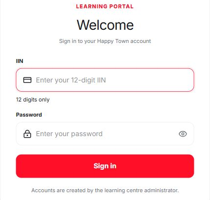

**Figure B1.** English sign-in form with empty fields, captured on 20 November 2026 at 14:11:50 CET. S20-HT-06-01. The display crop focuses on the form. These supplementary images show the running local site. Its exact build revision was not independently established for the new captures.

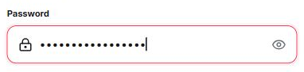
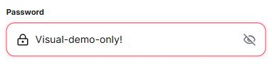
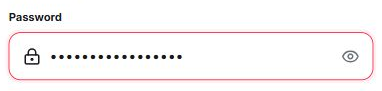

**Figure B2.** From top to bottom: masked, revealed and masked again. Captured in that order on 20 November 2026 at 14:11:57, 14:12:03 and 14:12:03 CET. S20-HT-06-02 through S20-HT-06-04. The visible text is a disposable demonstration string. It was cleared without submitting it. The input types matched the first three states recorded on 19 November. [Supplementary capture record](../evidence/supplementary/2026-11-20/capture-record.md)

**Source and sign-in evidence.** In components/login-form.tsx:17 the visibility flag starts at false. Line 38 binds the input type to that flag. The original HTTP observations separately recorded an incomplete sign-in with no issued session and ordinary sign-ins that issued sessions for all three roles (P3-HT-02, P3-HT-03 and observations.json / http.validation and http.ordinarySignIn).

### Exhibit C — Function-level authorization

**Recorded source.** P3-HT-14 (HT-14-evidence.md), observations.json / http.roles and app/api/admin/entities/route.ts:13. P3-HT-16 records the server-side guard trace. The table transcribes the 19 November results.

| Context for the sampled admin list | Response from the record | Admin items present | Observation key in http.roles |
| --- | --- | --- | --- |
| TEACHER-A | HTTP 403 · FORBIDDEN | No | teacherAdminApi |
| ADMIN-A | HTTP 200 | Yes | adminList |
| PARENT-A | HTTP 403 · FORBIDDEN | No | parentAdminApi |
| Unauthenticated | HTTP 401 · UNAUTHORIZED | No | anonAdminApi |

**What this supports.** The allowed administrator response confirms that the sampled management function was available and returned items. The matched teacher request was denied without the management payload. The route calls requireAdmin on the server. The 3302 follow-up used the same teacher-list GET for each role. ADMIN received 200 with items. TEACHER and PARENT received 403 without items. See the [sanitized Playwright record](../evidence/supplementary/2026-11-20/network/access-control-http.json) and [Figure S1](#supplementary-chrome-devtools-figures). The [21 November Chrome comparison](#evidence-exhibit-ht14-01) records the same GET under four authentication states.

### Exhibit D — Record-level authorization

**Recorded source.** P3-HT-15 (HT-15-evidence.md), observations.json / http.relationships and http.recordFixtures. The source trace references app/api/students/[id]/route.ts:6 and lib/auth/authorization.ts:40–50. The table transcribes the 19 November results.

| Synthetic request label | Relationship checked | Recorded HTTP status | Student data present |
| --- | --- | --- | --- |
| PARENT-A / student A | Linked student | 200 | Yes |
| PARENT-A / student B | Cross-parent read | 404 | No |
| PARENT-B / student B | Linked student | 200 | Yes |
| PARENT-B / student A | Cross-parent read | 404 | No |

**What this supports.** The audit database independently confirmed both parent relationships. Pairing an allowed read with the opposite denied read shows that access depends on the link to the individual student. This matters because each parent role handles school records, but permissions must remain specific to the family relationship. The comparison covered read-only synthetic records and the tested route.

**3302 follow-up.** PARENT-A received 200 for linked STU-01 and 404 without student data for STU-02. PARENT-C’s positive control was unavailable in this run because the account lacked sign-in credentials. The [earlier HTTP record](../evidence/supplementary/2026-11-20/network/access-control-follow-up.md) and [later two-parent comparison](../evidence/supplementary/2026-11-20/interim-20261120T164431Z/phase-2-execution.md) document separate runs. The [21 November Chrome comparison](#evidence-exhibit-ht15-01) pairs the linked and unlinked PARENT-A requests.

### Exhibit E — JWT logout invalidation

**Case and finding.** P3-HT-12 (HT-12-evidence.md) · HT-F01 · ASVS v5.0.0-7.4.1. The source excerpts come from the audited revision and its installed Auth.js dependency. Original HTTP evidence is in observations.json / http.logout and jwtExpiry.

#### Application configuration and trusted verification

**auth.ts:18** sets the JWT strategy and an eight-hour maximum age. **lib/auth/authorization.ts:10–13** checks session identity, role and account state.

~~~code
  session: { strategy: "jwt", maxAge: 60 * 60 * 8 },
  const session = await auth();
  if (!session?.user?.id || !session.user.role) return null;
~~~

#### Installed Auth.js behavior

The installed **signout.js:18, 28** invokes an optional sign-out event and clears the cookie. **session.js:24** decodes the JWT. The excerpts below are non-contiguous.

~~~code
            await events.signOut?.({ token });
    cookies.push(...sessionStore.clean());
            const payload = await jwt.decode({ ...jwt, token: sessionToken, salt });
~~~

| Recorded step in the original sample | Observation |
| --- | --- |
| Ordinary POST sign-out | HTTP 302. Client stopped holding the session cookie. |
| Session check after logout | HTTP 200 without a user |
| Sampled protected API after logout | HTTP 401 from the signed-out client |
| Isolated Auth.js expiry check | A fresh generated fixture decoded. The expired fixture was rejected. |

**What this supports.** The inspected logout path has no per-session revocation decision. The 3302 follow-up observed HTTP 200 from ordinary sign-out, then HTTP 200 without a user from the same browser's session endpoint. **Acceptance of the original JWT after logout was not tested.** See the [Playwright HTTP observations](../evidence/supplementary/2026-11-20/network/clone-browser-observations.json) and [Figure S2](#supplementary-chrome-devtools-figures).

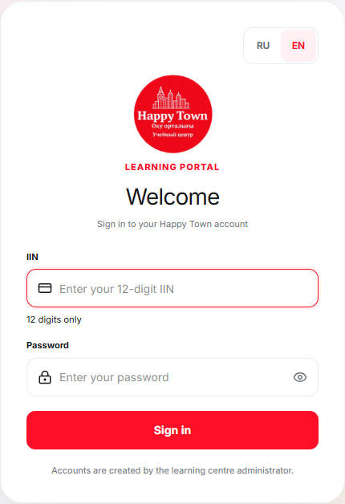

**Figures E1 and E2.** Playwright captures before and after ordinary logout on port 3302.

### Exhibit F — Sensitive contact search in a request URL

**Case and finding.** P3-HT-17 (HT-17-evidence.md) · HT-F02 · ASVS v5.0.0-14.2.1. The fragments correspond to the audited revision. This exhibit preserves the 19 November metadata. Exhibit I records the independent Playwright request and response on port 3302.

#### Client, route and data-layer source

**components/admin-database-portal.tsx:45** includes the search text in URLSearchParams and passes the query to the admin URL. The two expressions are excerpted from the same source line.

~~~code
new URLSearchParams({kind,query,status,sort,page:String(page),pageSize:String(pageSize)})
const payload=await requestJson(locale,`/api/admin/entities?${params}`);
~~~

**app/api/admin/entities/route.ts:13** reads the query parameter after the administrator guard. **lib/repositories/admin.repository.ts:88** includes an email match for the parent or teacher search path described on lines 86–90.

~~~code
query:url.searchParams.get("query")||""
{email:{contains:query,mode:"insensitive"}}
~~~

| Recorded field | Value in observations.json / http.requestLocations.syntheticContactSearch |
| --- | --- |
| method and path | GET · /api/admin/entities |
| fields | kind, query |
| status | 200 |
| syntheticEmailWasInUrl | true |
| matchedFixture | true |

**What this supports.** The client serializes the search term into the URL query. The authorized backend reads that parameter and includes email in its matching logic. This creates a path for contact data to enter systems that record URLs, such as access logs or diagnostics. The retained observation uses a synthetic teacher email and stores a presence flag. **Downstream logging, retention and disclosure were outside the observed sample.** RFC 9110 §17.9 describes the general sensitivity of URI contents.

### Exhibit G — Credential-abuse documentation

**Case and finding.** P3-HT-05 (HT-05-evidence.md) · HT-F03 · ASVS v5.0.0-6.1.1. The authoritative evidence for the revised verdict is RA-2026-11-19-DOC (2026-11-19-documentation-review.md), “Inventory and method” and “Determinations.”

**Inventory boundary.** The reassessment listed 187 tracked paths at the audited revision. Its standalone text documentation consisted of the root README.md and I18N_REMAINING.md. No tracked application policy directory appeared. The audit planning documents describe the test sample. The finding is limited to application documentation made available for the review.

| Required documentation element | Documents inspected | Found | Absent or incomplete | Evidence reference |
| --- | --- | --- | --- | --- |
| Defenses and scope | README.md lines 48–57 and localization QA notes | README names a hashed, in-memory rate-limit key. The other document covers localization QA. | Written operating scope and how the stated control addresses credential stuffing and password brute force. | P3-HT-05 |
| Configuration | README.md lines 24–30 and 48–57, plus localization QA notes | Setup describes synthetic account provisioning. The README identifies the limiter mechanism. | Effective threshold, window and reset conditions in the available documentation. | RA-2026-11-19-DOC |
| Malicious account lockout | README.md lines 48–57 and localization QA notes | No complete governing policy located in the materials reviewed. | Explanation of how the configured controls prevent malicious lockout. | RA-2026-11-19-DOC |

**What this supports.** The criterion requires documentation of controls, configuration and malicious-lockout safeguards. The table distinguishes what the README says from the missing detail. The original isolated limiter evidence remains relevant to HT-07. The documentation failure does not establish failed runtime credential-abuse protection. Separately held policies were outside the submitted evidence.

### Exhibit H — Authorization documentation

**Case and finding.** P3-HT-13 (HT-13-evidence.md) · HT-F04 · ASVS v5.0.0-8.1.1. See RA-2026-11-19-DOC (2026-11-19-documentation-review.md), HT-13 determination. Application documentation cited here is the root README at the audited Git revision.

#### Relevant README excerpts

README.md:52–53 describes protected pages, ADMIN mutations and record ownership checks. README.md:69 also describes separate historical relationship rows. The original wording of lines 52–53 is shown below.

~~~quotation
- Protected pages validate the session and role on the server. Admin mutation routes independently require ADMIN and do not trust a client-supplied actor.
- Parent/student and teacher/group/student reads apply server-side ownership checks and return safe 401/403/404 responses.
~~~

| Access area | Documented rule | Detail still insufficient |
| --- | --- | --- |
| ADMIN functions | Mutations independently require ADMIN (README.md:52). | Role-to-function rules for the sampled portal and management reads, and how denials or exceptions apply. |
| TEACHER records | Ownership checks apply to teacher/group/student reads (README.md:53). | How current assignments, active enrolments and relevant lifecycle states affect access. Compare lib/auth/authorization.ts:40–45. |
| PARENT records | Ownership checks apply to parent/student reads (README.md:53). Parent-to-student links are modeled separately (line 69). | Which link states qualify, including archived relationships, and expected access or denial across the sampled records. Compare lib/auth/authorization.ts:48–49. |

**What this supports.** The documentation supplies high-level controls without enough detail to guide future maintenance consistently. **HT-14, HT-15 and HT-16 passed** for the sampled function-level, record-level and trusted-layer checks. This finding concerns the documentation reviewed. Separately held policies were outside the submitted evidence.

### Exhibit I — Isolated contact-search validation

**HT-17 on 3302.** At 16:58:06.902 CET on 20 November 2026, ADMIN searched for the reserved-domain synthetic teacher email in the English Teachers interface. Playwright recorded `GET /api/admin/entities`, the URL with the exact email in `query`, and HTTP 200 with one matching fixture. The browser test established URL placement. It did not measure retention or third-party disclosure. The [HTTP observation](../evidence/supplementary/2026-11-20/final-validation/ht17-http-observation.json) records the request URL.

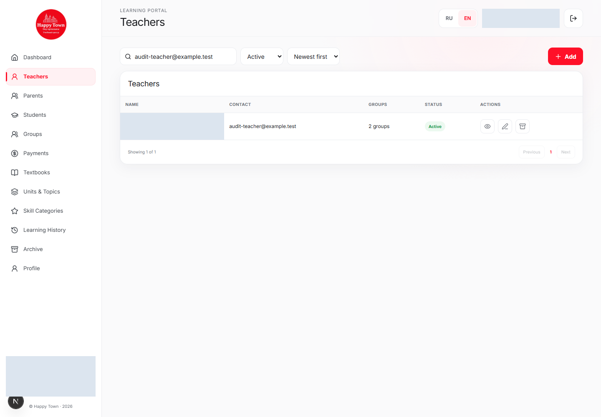

**Figure I1.** FV-HT17-01. Full English Playwright viewport, with names and sidebar contact masked at capture.

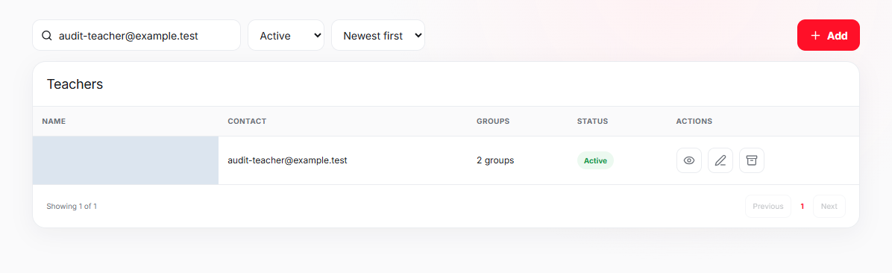

**Figure I2.** FV-HT17-02. Same search and result at a readable scale. The [capture register](../evidence/supplementary/2026-11-20/final-validation/final-validation.md) includes the image hashes. See [Figure S3](#supplementary-chrome-devtools-figures) for the Chrome request.

## 12. Verification results

| Outcome | Original fieldwork | Final | Interpretation |
| --- | ---: | ---: | --- |
| Pass | 11 | 11 | Evidence supports the sampled criterion. |
| Fail | 2 | 5 | Evidence establishes a deviation. |
| Inconclusive | 4 | 1 | Evidence is insufficient to determine conformity. |
| Total | 17 | 17 | Each case had fieldwork in whole or in part. |

**Why three conclusions changed.** Documentation reassessment established Fail for HT-05 and HT-13. The [independent HT-11 source review](../evidence/supplementary/2026-11-20/ht11-independent-source-review/HT11-fail-determination-and-proposed-changes.md) established Fail for HT-11. The historical fieldwork decisions are preserved.

| Open case | Evidence already available | Evidence needed to resolve |
| --- | --- | --- |
| HT-07 · v5.0.0-6.3.1 | P3-HT-07 and observations.json / limiter show isolated threshold, reset, key separation and recovery behavior. The sign-in source calls the limiter. | HT07-BASELINE-v0.1 was approved on 21 November 2026 CET. The prospective comparison is Fail. Representative live limiter evidence remains outstanding. |

**HT-11 dynamic evidence gap.** The Dynamic Replay Test remains Inconclusive. The [same-context Playwright run](../evidence/supplementary/2026-11-20/ht11-same-context-20261120T190133Z/HT11-same-context-execution.md) confirmed a second login and protected access. The [HT-11 replay record](../evidence/supplementary/2026-11-20/ht11-final-dynamic-20261120T212722Z/HT11-final-dynamic-execution.md) confirms that the prior JWT was never tested after re-authentication.

The existing Pass decisions for HT-14 and HT-15 are corroborated by the 21 November native exhibits. HT-14 compares four authentication states ([HT14-01](#evidence-exhibit-ht14-01) · [HT14-02](#evidence-exhibit-ht14-02) · [HT14-03](#evidence-exhibit-ht14-03) · [HT14-04](#evidence-exhibit-ht14-04)). HT-15 compares linked and unlinked records for PARENT-A ([HT15-01](#evidence-exhibit-ht15-01) · [HT15-02](#evidence-exhibit-ht15-02)).

## 13. Detailed findings

### HT-F01 — Logout lacks server-side JWT invalidation

**HT-12 · ASVS v5.0.0-7.4.1 · Medium · Open.** The criterion requires logout or expiry to make the terminated session unusable at the backend.

**Condition and cause.** The configured Auth.js JWT flow clears the client cookie on sign-out and records no server-side revocation decision. The inspected server checks JWT validity and the current account. Normal logout changes neither. Exhibit E shows the configuration, the dependency’s cookie cleanup and the observed HTTP 401 from the signed-out client. The separate expiry check rejected a dummy token. The finding concerns the inspected implementation. Previous-session acceptance was not tested. **Evidence.** P3-HT-12, original HTTP and expiry observations, and the ordinary logout follow-up in Exhibit E.

**Risk.** Likelihood is **Low** because continued access would require prior possession of a valid session artifact and access to the loopback instance. Impact is **High** because retained administrator privileges could allow access to management records and functions. These are conditional consequences. The course matrix gives **Medium** risk.

**Recommendation and closure.** Keep durable per-session revocation state and have the server consult it consistently, including after renewal. Use an authorized, isolated synthetic follow-up to verify that the server rejects revoked and expired sessions and that revocation persists. Corroborate with ordinary sign-out, retaining only redacted state and outcome indicators.

**Related control deviation, HT-11 · ASVS v5.0.0-7.2.4 · Fail (source-based).** The [independent HT-11 source review](../evidence/supplementary/2026-11-20/ht11-independent-source-review/HT11-fail-determination-and-proposed-changes.md) found that re-authentication issues a fresh JWT without revoking its predecessor. This shares HT-F01’s server-side revocation gap under a distinct trigger. The old JWT was never tested after re-authentication. HT-F01 remains Medium and the register contains four findings.

### HT-F02 — Admin contact search includes email in a request URL

**HT-17 · ASVS v5.0.0-14.2.1 · Low · Open.** The criterion keeps sensitive inputs out of URLs and places them in the request body or headers.

**Condition and cause.** The client includes free-text search in the URL query and the server can match it against email. The original request and the 3302 Playwright follow-up each returned HTTP 200 and matched a synthetic teacher. The follow-up captured the exact email in the query. **Evidence.** P3-HT-17 and FV-HT17-01/02 in Exhibits F and I.

**Risk.** Likelihood is **Medium** because the placement occurs during normal admin search. Impact is **Low** for the observed contact field. Components that retain URLs could retain the term. The audit established neither downstream retention nor disclosure.

**Recommendation and closure.** Use an authorized, validated POST body for contact search and exclude values from sampled logs, traces and caches. Confirm that a synthetic search still works, the term stays out of the URL and available logs, and the server still requires the intended role.

### HT-F03 — Insufficient credential-abuse protection documentation

**HT-05 · ASVS v5.0.0-6.1.1 · Low · Open.** The criterion requires documentation of defenses, configuration and prevention of malicious account lockout.

**Condition and cause.** The reviewed README names a hashed, in-memory limiter and does not specify effective settings, reset behavior or malicious-lockout safeguards. The available records give no cause for the documentation omission. Exhibit G documents the sources, scope and missing elements. **Evidence.** P3-HT-05 and RA-2026-11-19-DOC.

**Risk.** Likelihood is **Medium** because routine maintenance can rely on incomplete guidance. Impact is **Low** for the direct reduction in assurance. The finding does not establish failed runtime protection.

**Recommendation and closure.** Maintain the approved credential-abuse baseline and ensure the documentation covers settings, reset and lockout safeguards. Evaluate implementation separately under HT-07.

### HT-F04 — Insufficient authorization documentation

**HT-13 · ASVS v5.0.0-8.1.1 · Low · Open.** The criterion requires documentation of function and data access by permissions and resource attributes.

**Condition and cause.** The reviewed README summarizes server role and ownership checks without specifying the governing permissions, relationship states and denials. The available records give no cause for the documentation omission. Exhibit H compares the written rules with sampled server behavior. **Evidence.** P3-HT-13 and RA-2026-11-19-DOC.

**Risk.** Likelihood is **Low** because a harmful outcome would require a future inconsistent implementation or review decision. Impact is **Medium** for potential exposure of a bounded set of school records. Sampled enforcement passed.

**Recommendation and closure.** Approve a versioned authorization policy and role–permission matrix. Check functions, record attributes, lifecycle states and exceptions. Compare representative documented rules with the backend decisions.

## 14. Risk assessment and risk matrix

Likelihood is **Low** when a separate prerequisite is necessary in the scoped lab, **Medium** when an ordinary workflow or maintenance condition enables the scenario, and **High** when the exposure is direct and readily reachable. Impact is **Low** for a limited effect, **Medium** for a material but bounded consequence and **High** for substantial exposure or continued privileged access. The [risk methodology](../findings/risk-assessment.md#qualitative-risk-method) defines these levels.

| Finding | Class | Likelihood | Impact | Risk |
| --- | --- | --- | --- | --- |
| HT-F01 | Technical | Low | High | **Medium** |
| HT-F02 | Technical | Medium | Low | **Low** |
| HT-F03 | Documentation | Medium | Low | **Low** |
| HT-F04 | Documentation | Low | Medium | **Low** |

| Likelihood / Impact | Low | Medium | High |
| --- | --- | --- | --- |
| Low | Low | Low · HT-F04 | Medium · HT-F01 |
| Medium | Low · HT-F02, HT-F03 | Medium | High |
| High | Medium | High | Critical |

HT-F01 requires prior possession and local reachability, with potentially privileged impact. HT-F02 occurs during ordinary admin search and concerns the sampled contact field. HT-F03 affects assurance during routine maintenance. HT-F04 could affect a bounded record set if a future inconsistent change occurs. The [risk assessment](../findings/risk-assessment.md) records the rationale.

## 15. Recommendations and corrective action plan

| Finding | Proposed action | Closure evidence |
| --- | --- | --- |
| HT-F01 | Enforce durable server-side revocation at logout. Address this finding first. | Updated control design and isolated proof that revoked or expired sessions are rejected. |
| HT-F02 | Use a validated POST body and keep sensitive terms out of logs and caches. | Allowed search works and the synthetic search term remains out of request URLs and sampled logging. |
| HT-F03 | Maintain the approved credential-abuse baseline and document settings, recovery and lockout safeguards. | Versioned policy mapped to configuration and a separate comparison under HT-07. |
| HT-F04 | Approve an authorization policy and role–permission matrix with resource rules and exceptions. | Versioned policy covering the required rules and representative comparison to server enforcement. |

**HT-11 re-authentication follow-up.** The [independent HT-11 source review](../evidence/supplementary/2026-11-20/ht11-independent-source-review/HT11-fail-determination-and-proposed-changes.md) supports applying server-side revocation to session replacement and to HT-F01’s logout trigger. Closure requires evidence that after re-authentication the server denies the superseded session and accepts its replacement for the intended account.

The Project Owner is responsible for treatment. Target dates and a formal auditee response remain pending. The [corrective action plan](../findings/remediation-plan.md) lists the proposed actions.

## 16. Overall conclusion

The sampled server-side validation, account provisioning, fresh token issuance and role and record restrictions supported their tested requirements. The register contains two technical findings and two documentation findings. Five verification criteria failed, including HT-11, which shares the server-side revocation gap addressed by HT-F01. Historically, HT-07 was Inconclusive. HT-11 is Fail on source evidence, with prior-token replay after re-authentication dynamically Inconclusive. HT-12 has an implementation finding and an untested replay scenario. The PARENT-C positive control was unavailable in the first supplemental run. Exhibit D identifies the later two-parent evidence. The findings apply to one local revision and the sampled criteria, with a disclosed self-review limitation. [Final verification matrix](../asvs/verification-matrix.csv) · [Risk assessment](../findings/risk-assessment.md)

## 17. References

- OWASP Foundation. *Application Security Verification Standard 5.0.0*. [Official release](https://asvs.owasp.org/downloads/) · [Official English CSV](https://raw.githubusercontent.com/OWASP/ASVS/v5.0.0/5.0/docs_en/OWASP_Application_Security_Verification_Standard_5.0.0_en.csv)
- OWASP Foundation. *Session Management Cheat Sheet*. [Session expiration and invalidation](https://cheatsheetseries.owasp.org/cheatsheets/Session_Management_Cheat_Sheet.html#automatic-session-expiration)
- IETF. *RFC 9110: HTTP Semantics*, June 2022. [Section 17.9, sensitive information in URIs](https://www.rfc-editor.org/rfc/rfc9110.html#section-17.9)
- Óbuda University course materials. *Requirements*, slide 16. *Audit documentation*, slides 3–10 and 12–20. *The auditor*, slides 7 and 10–21. *Strategy*, slides 8–19. [Course material inventory](../audit-plan/audit-plan.md#course-materials-and-application-to-this-plan)

- Project audit records. The Phase 3 environment and observations, original execution record, final verification matrix, findings register and dated reassessment are identified by filename or evidence ID in the exhibits. [Evidence register](../evidence/evidence-register.md)

## 18. Evidence traceability appendix

The table links each final decision to a stable evidence reference. P3-HT-nn maps to HT-nn-evidence.md. RA-2026-11-19-DOC maps to 2026-11-19-documentation-review.md, the final basis for HT-05 and HT-13. HT11-SRC maps to HT11-fail-determination-and-proposed-changes.md. HT11-DYN maps to HT11-final-dynamic-execution.md.

| ASVS requirement | Test ID | Verification activity | Evidence reference | Final result |
| --- | --- | --- | --- | --- |
| v5.0.0-1.2.4 | HT-01 | Trace Prisma query arguments and corroborate sampled HTTP lookups | P3-HT-01 | Pass |
| v5.0.0-2.2.1 | HT-02 | Compare valid and invalid inputs and review fixture outcomes | P3-HT-02 · Exhibit B | Pass |
| v5.0.0-2.2.2 | HT-03 | Trace server validation and verify sampled rejection | P3-HT-03 · Exhibit B | Pass |
| v5.0.0-3.5.3 | HT-04 | Compare HTTP methods and sampled state changes | P3-HT-04 | Pass |
| v5.0.0-6.1.1 | HT-05 | Compare documented settings and lockout safeguards to ASVS | P3-HT-05 · RA-2026-11-19-DOC · Exhibit G | Fail |
| v5.0.0-6.2.6 | HT-06 | Observe initial mask, reveal, restoration and reload in Chrome | P3-HT-06 · Exhibit B | Pass |
| v5.0.0-6.3.1 | HT-07 | Trace the sign-in guard and observe the isolated limiter | P3-HT-07 · §12 | Fail |
| v5.0.0-6.3.2 | HT-08 | Review seed provenance and reconcile usable fixture logins | P3-HT-08 | Pass |
| v5.0.0-7.2.1 | HT-09 | Trace backend verification and compare anonymous reads | P3-HT-09 · Exhibit E | Pass |
| v5.0.0-7.2.2 | HT-10 | Compare token issuance to two separate fresh sessions | P3-HT-10 | Pass |
| v5.0.0-7.2.4 | HT-11 | Trace Credentials re-authentication, JWT issuance, session validation and the protected teacher guard | P3-HT-11 · [HT11-SRC](../evidence/supplementary/2026-11-20/ht11-independent-source-review/HT11-fail-determination-and-proposed-changes.md) · [HT11-DYN](../evidence/supplementary/2026-11-20/ht11-final-dynamic-20261120T212722Z/HT11-final-dynamic-execution.md) · §12 | Fail (source-based). Dynamic Replay Test Inconclusive. |
| v5.0.0-7.4.1 | HT-12 | Trace sign-out and backend checks, observe logout and expiry | P3-HT-12 · Exhibit E | Fail |
| v5.0.0-8.1.1 | HT-13 | Compare written permissions and resource rules to the criterion | P3-HT-13 · RA-2026-11-19-DOC · Exhibit H | Fail |
| v5.0.0-8.2.1 | HT-14 | Compare allowed and denied role requests to management | P3-HT-14 · Exhibit C · [HT14-01](#evidence-exhibit-ht14-01) · [HT14-02](#evidence-exhibit-ht14-02) · [HT14-03](#evidence-exhibit-ht14-03) · [HT14-04](#evidence-exhibit-ht14-04) | Pass |
| v5.0.0-8.2.2 | HT-15 | Pair linked and cross-parent reads against verified fixtures | P3-HT-15 · Exhibit D · [HT15-01](#evidence-exhibit-ht15-01) · [HT15-02](#evidence-exhibit-ht15-02) | Pass |
| v5.0.0-8.3.1 | HT-16 | Trace server guards and corroborate with sampled requests | P3-HT-16 · Exhibits C and D | Pass |
| v5.0.0-14.2.1 | HT-17 | Trace contact-search construction and inspect request metadata | P3-HT-17 · Exhibits F and I | Fail |

### Supplementary Chrome DevTools figures

Captured in Chrome on the isolated audit instance on 21 November 2026 CET. The earlier Chrome captures are on PDF page 15. The native authorization exhibits are on pages 16–21. The [packaged evidence index](../evidence/supplementary/2026-11-21/chrome-native-devtools-captures/evidence-index.md) identifies the native capture sources.

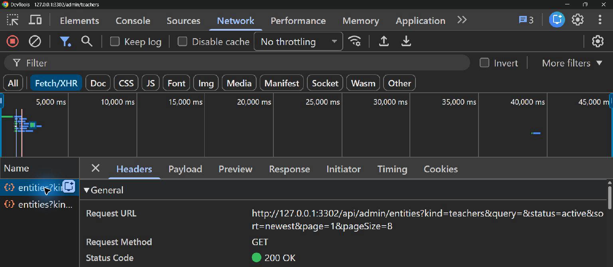

**Figure S1. HT-14 · Administrator teacher-list request · 21 November 2026.** GET /api/admin/entities returned HTTP 200 in the ADMIN fixture session. The image covers the allowed sample. The earlier TEACHER and PARENT denial results remain in Exhibit C’s HTTP record.

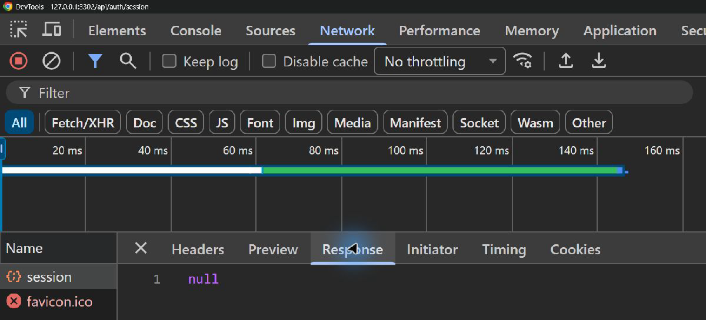

**Figure S2. HT-12 · Signed-out browser session check · 21 November 2026.** GET /api/auth/session returned HTTP 200 with a JSON null response after ordinary sign-out. This establishes the browser’s signed-out state. The earlier JWT was never resubmitted.

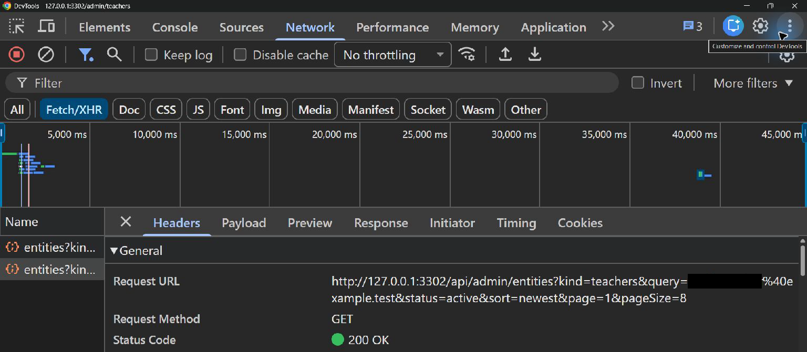

**Figure S3. HT-17 · Synthetic email in the request URL · 21 November 2026.** The Teachers page sent a GET request with the synthetic email in the query parameter, and the server returned HTTP 200. The local part is masked. The paired HTTP record confirms a single matching fixture. Downstream retention was not tested.

### Evidence exhibit HT14-01

**ADMIN received the teacher list.** HT-14 · v5.0.0-8.2.1 · ADMIN · HTTP 200.

`GET /api/admin/entities?kind=teachers` on 21 November 2026 at 19:51:55 CET. The administrative GET returned a non-empty items array for ADMIN, establishing the allowed baseline for the same resource.

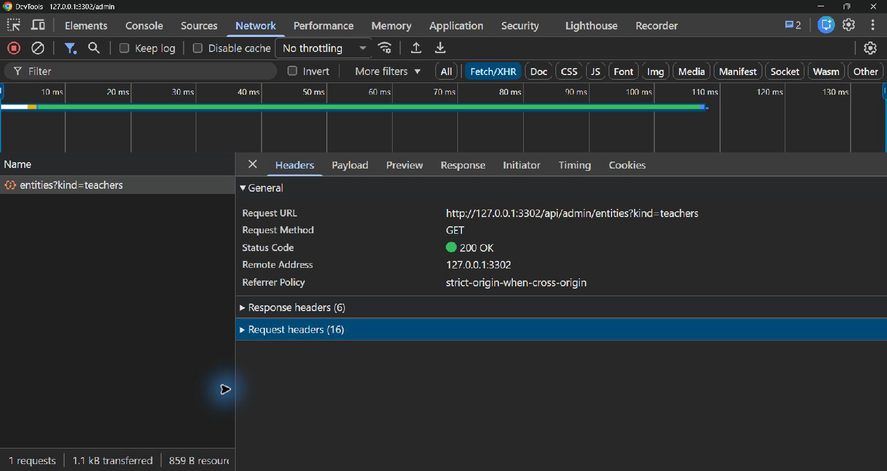

**Figure HT14-01-headers.** DevTools Headers shows the request URL, GET and the actual HTTP status.

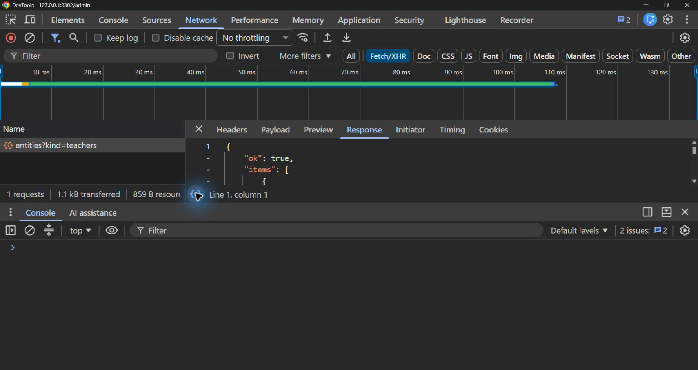

**Figure HT14-01-response.** DevTools Response shows the server body for the same request.

### Evidence exhibit HT14-02

**TEACHER was denied the teacher list.** HT-14 · v5.0.0-8.2.1 · TEACHER · HTTP 403.

`GET /api/admin/entities?kind=teachers` on 21 November 2026 at 19:40:41 CET. The administrative GET returned FORBIDDEN to TEACHER without management items.

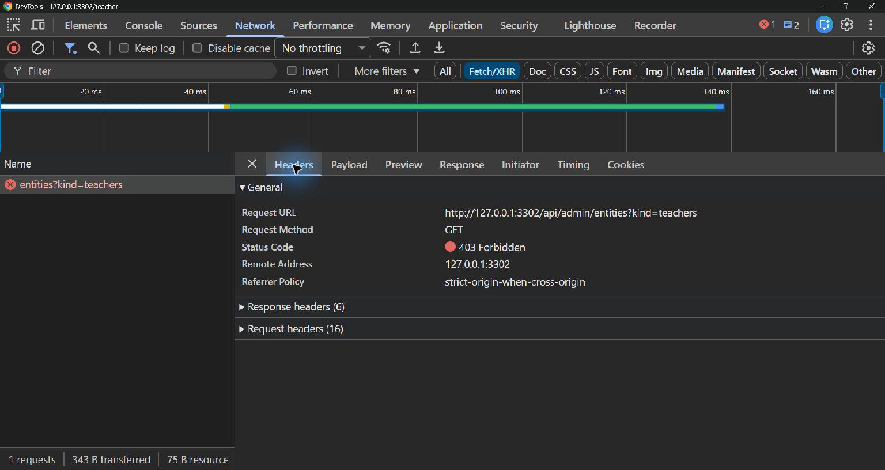

**Figure HT14-02-headers.** DevTools Headers shows the request URL, GET and the actual HTTP status.

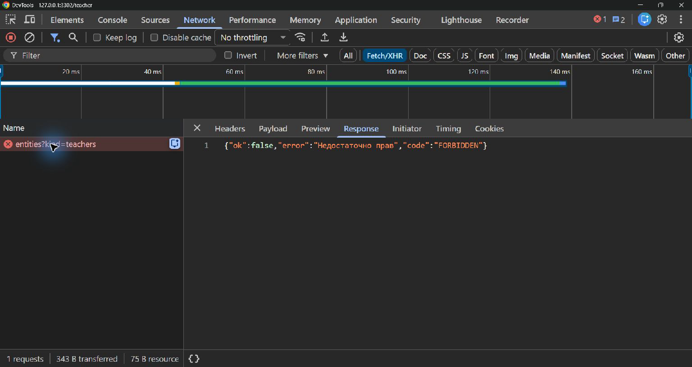

**Figure HT14-02-response.** DevTools Response shows the server body for the same request.

### Evidence exhibit HT14-03

**PARENT was denied the teacher list.** HT-14 · v5.0.0-8.2.1 · PARENT · HTTP 403.

`GET /api/admin/entities?kind=teachers` on 21 November 2026 at 19:46:04 CET. The administrative GET returned FORBIDDEN to PARENT without management items.

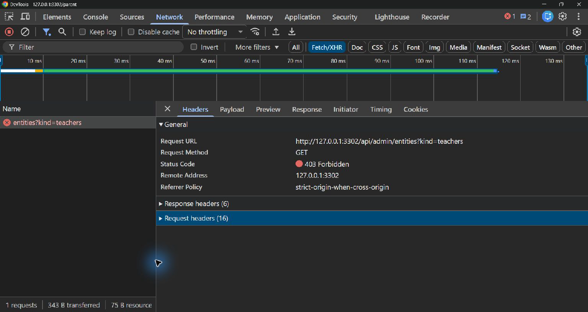

**Figure HT14-03-headers.** DevTools Headers shows the request URL, GET and the actual HTTP status.

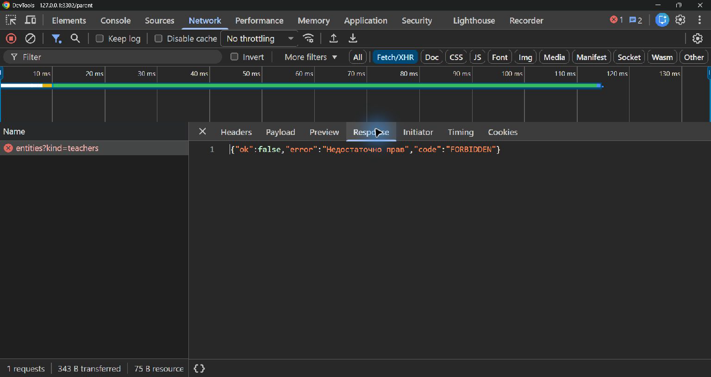

**Figure HT14-03-response.** DevTools Response shows the server body for the same request.

### Evidence exhibit HT14-04

**Anonymous client was denied the teacher list.** HT-14 · v5.0.0-8.2.1 · Anonymous · HTTP 401.

`GET /api/admin/entities?kind=teachers` on 21 November 2026 at 19:38:54 CET. The administrative GET returned UNAUTHORIZED to a client without an authenticated session and omitted management items.

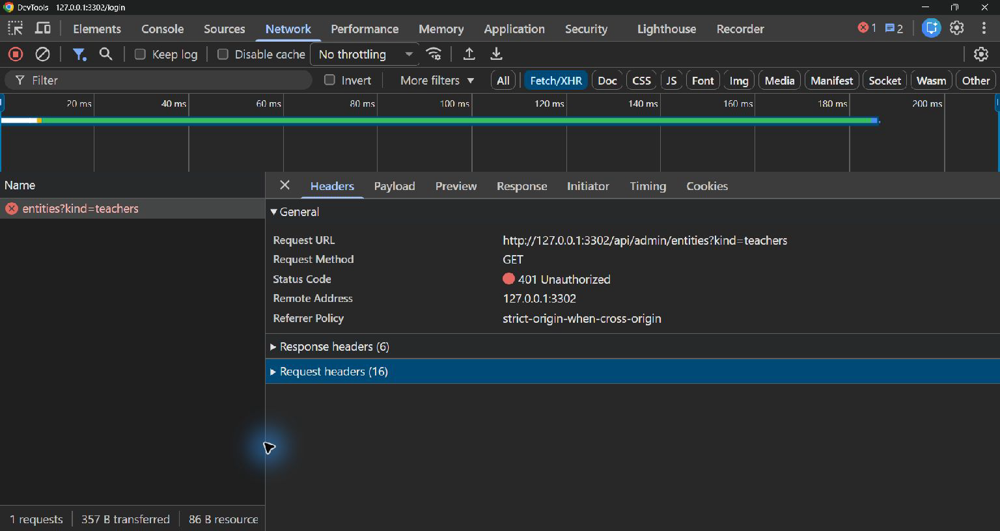

**Figure HT14-04-headers.** DevTools Headers shows the request URL, GET and the actual HTTP status.

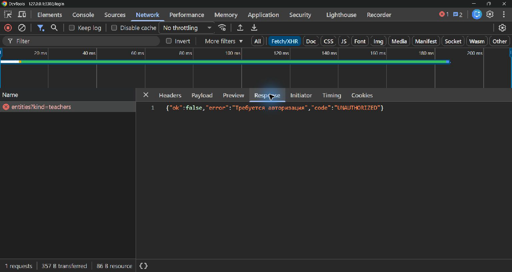

**Figure HT14-04-response.** DevTools Response shows the server body for the same request.

### Evidence exhibit HT15-01

**PARENT-A received linked student STU-01.** HT-15 · v5.0.0-8.2.2 · PARENT-A · HTTP 200.

`GET /api/students/[STU-01]` on 21 November 2026 at 19:47:11 CET. The GET returned a student object with the identifier of STU-01. The isolated fixture check independently confirmed the active PARENT-A relationship.

**Figure HT15-01-headers.** DevTools Headers shows the request URL, GET and the actual HTTP status.

**Figure HT15-01-response.** DevTools Response shows the server body for the same request.

### Evidence exhibit HT15-02

**PARENT-A was denied unlinked student STU-02.** HT-15 · v5.0.0-8.2.2 · PARENT-A · HTTP 404.

`GET /api/students/[STU-02]` on 21 November 2026 at 19:46:40 CET. The same account received a not-found response to the GET for STU-02. The response contained no student object. The fixture check confirmed STU-02 had no active link to PARENT-A.

**Figure HT15-02-headers.** DevTools Headers shows the request URL, GET and the actual HTTP status.

**Figure HT15-02-response.** DevTools Response shows the server body for the same request.

### Follow-up verification and evidence

**21 November 2026 CET · Audited revision f23375fee54bae8942a1c23a702adb04ed6c99a2**

**17 requirements · 11 Pass · 5 Fail · 1 Inconclusive · 4 open findings**

#### HT-07 · Credential-abuse protection

The criterion expects the sign-in defenses to operate according to the application's security documentation. The original isolated limiter check established the threshold, key separation, reset and recovery at the module boundary. The follow-up ran the audited Credentials provider and limiter together with in-memory dependencies and a simulated clock. Five checks passed, covering denial before lookup, two failure branches, reset after success and recovery at the configured boundary.

A separate unauthenticated GET /login returned HTTP 200 with an HTML password input on the isolated audit listener. This establishes page availability. HT-07 was Inconclusive in fieldwork. The Project Owner approved the baseline on 21 November 2026 CET. The prospective comparison is Fail, and full live limiter behavior remains unobserved. [RV-HT07-PROVIDER](../evidence/supplementary/2026-11-21/criterion-recheck/ht07-provider-results.txt) · [RV-HT07-HTTP](../evidence/supplementary/2026-11-21/criterion-recheck/ht07-public-http.json)

#### HT-11 · Session replacement

The criterion expects authentication to issue a fresh session and terminate the one it supersedes. The inspected JWT implementation lacks server-side termination on re-authentication, supporting the source-based Fail. The retained Playwright record shows HTTP 200 for the second authentication and HTTP 200 for the current context's subsequent protected request. The earlier session's protected-route outcome remains unobserved, so the separate Dynamic Replay Test remains Inconclusive. Closure requires a redacted response attributable to the superseded session after re-authentication. [HT11-DYN](../evidence/supplementary/2026-11-20/ht11-final-dynamic-20261120T212722Z/HT11-final-dynamic-execution.md)

#### Evidence and assurance

The recheck traced all 17 conclusions to the original and supplementary artifacts and reconciled the matrix, register, report and defense slides. The offline session and role suites recorded 32 passes and two session-lifecycle TODOs. Native HT-14 and HT-15 exhibits remain on pages 16–21. This recheck is part of the academic self-assessment. External auditor sign-off remains outstanding. [Per-criterion verification](../evidence/supplementary/2026-11-21/criterion-recheck/review.md) · [Final quality review](final-quality-review.md)

### Evidence after baseline approval

**21 November 2026 CET · Audited revision f23375fee54bae8942a1c23a702adb04ed6c99a2**

**Historical assessment · 17 requirements · 11 Pass · 5 Fail · 1 Inconclusive · 4 open findings**

#### HT-07 · Comparison after approval

The Project Owner approved a prospective operating baseline for the isolated revision. It calls for a 15-minute pause beginning at the sixth failed verification within a rolling 15-minute window. The audited limiter denies after five recorded failures and recovers ten minutes after the first. The follow-up baseline comparison is Fail. The original matrix records the evidence available before approval.

The audited provider passed five offline behavioral checks. The browser's single mismatched sign-in produced an HTTP 200 callback carrying an error and a separate HTTP 200 session response with no user. A read-only audit-log query corroborated the rejection. Live threshold, throttle denial, account separation, reset and recovery were not measured in this run. [Policy approval](../evidence/supplementary/2026-11-21/remaining-evidence/HT07-baseline-approval.md)

#### HT-11 · Concurrent access

With the same synthetic account, Context A received HTTP 200 and rendered the protected dashboard after a successful independent sign-in in Context B. A's session endpoint also returned HTTP 200 and the matched TEACHER identity. B's independent sign-in did not replace A's existing browser session. The separate Dynamic Replay Test remains Inconclusive for an actually superseded session. The criterion remains Fail on source evidence.

#### HT-12 · Ordinary logout

POST sign-out returned HTTP 200. The same browser's session endpoint then returned HTTP 200 without a user. The historical protected API returned HTTP 401 after ordinary logout. Acceptance of an earlier session after logout remains unobserved. The source-based Fail remains open.

The follow-up retained redacted Playwright observations, a dashboard crop and SHA-256 checksums. Chrome DevTools images for these three tests were unavailable. The historical HT-14 and HT-15 exhibits remain the evidence for their cases. [Follow-up working paper](../evidence/supplementary/2026-11-21/remaining-evidence/working-paper.md)

### Final evidence disposition and AI use

*The final assessment covers 17 requirements, 11 Pass, 6 Fail and 0 Inconclusive, with four open findings. HT07-BASELINE-v0.1 is Approved, effective 21 November 2026 CET. The prospective configuration comparison is Fail. The full live limiter sequence remains unobserved. HT-11 and HT-12 remain Fail on source evidence. Actual superseded-session and pre-logout-session acceptance were not observed. New native Chrome DevTools evidence for those incomplete scenarios is unavailable. The HT-15 submission copies use verified masks on the retained native captures.* [AI1]

[Final evidence disposition](../evidence/supplementary/2026-11-21/remaining-evidence/final-evidence-disposition.md) · [HT-15 redacted evidence](../evidence/supplementary/2026-11-21/submission-redactions/HT-15/README.md)

### Használt Mesterséges Intelligencia Eszközök

[AI1] OpenAI, Codex desktop, GPT-6 family. Exact deployed revision unavailable. Used on 21 November 2026 to draft and edit the follow-up material, write evidence and validation scripts, compare records, prepare deterministic redactions and package the report and slides. Follow-up text and submission preparation were AI-assisted. Browser observations and original captures are recorded in the working papers. [Full disclosure](ai-use-disclosure.md) · [Óbuda University AI policy](https://uni-obuda.hu/szabalyzatok/10-mesterseges-intelligenciaval-kapcsolatos-szabalyzatok/1-ai-oktatasi-terulet-szabalyzata/)

### Final validation preflight

*FDV-ENV-01 verified the loopback listener, clean audited revision and isolated database. FDV-HT07-PUBLIC records HTTP 200 for an unauthenticated GET /login. This was a reachability check. No credential submissions or new DevTools captures were recorded during final validation.* [AI1] [Evidence index](../evidence/supplementary/2026-11-21/final-dynamic-validation/evidence-index.md)

## Final adjudication

The final matrix records **11 Pass, 6 Fail and 0 Inconclusive** across 17 requirements. The earlier 11/5/1 assessment remains historical. HT-07 is Fail on source comparison with the approved prospective baseline. Actual live lockout and timed recovery were not observed. HT-11 is Fail on source evidence. A remained able to access the teacher dashboard after B independently signed in as the same teacher. Acceptance of the exact superseded credential remains unobserved. HT-12 is Fail on source evidence. Ordinary logout was observed, and acceptance of the earlier session remains unobserved. Four findings remain open, one Medium and three Low.

[HT-07 source adjudication](../evidence/supplementary/2026-11-21/final-adjudication-source-review.md) · [HT-11 reassessment](../evidence/supplementary/2026-11-21/ht11-context-reassessment.md)
